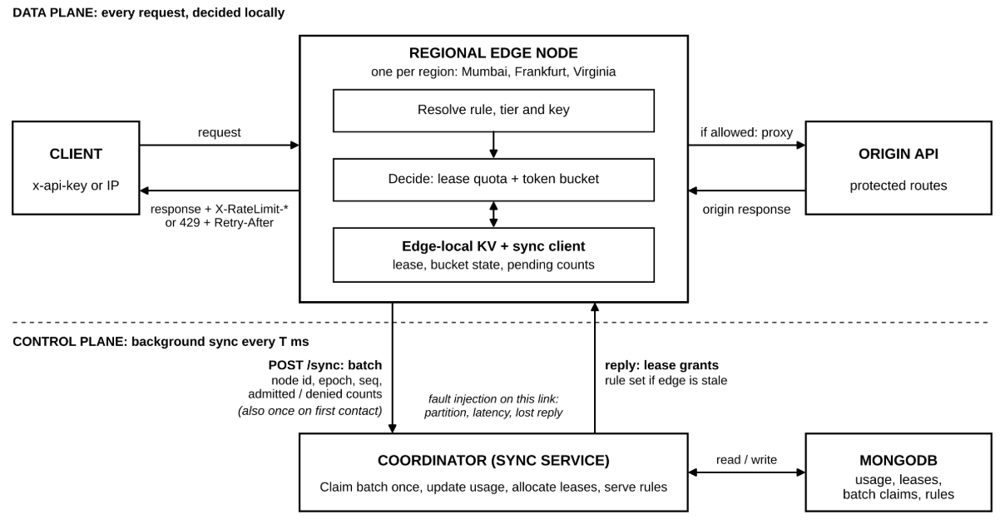

# EdgeGate

EdgeGate is an edge-based distributed rate-limiting middleware prototype.
Regional edge nodes make admission decisions from local memory, while a
coordinator distributes leases from one shared global quota and reconciles
usage in batches.

It demonstrates the core distributed-systems trade-off:

> Keep the request path local and fast without turning each region into an
> independent, globally inaccurate rate limiter.

## What it demonstrates

- Multiple regional edge nodes in front of one protected origin API.
- Token-bucket burst control and a two-bucket sliding-window approximation.
- Demand-aware quota leases allocated by a coordinator.
- Batched, idempotent usage synchronization.
- In-memory per-edge state with bounded LRU eviction.
- MongoDB-backed coordinator state, including MongoDB Atlas support.
- Fault simulation for partitions, latency, jitter, lost replies, and crashes.
- A React landing page and live operator console.

The edge nodes are simulated as separate Node.js processes. The rate-limiting
engine and admission logic are runtime-independent; the Node HTTP process is
the local edge-worker adapter used for this project.

## Architecture



The browser sends each request to one of the regional edge nodes. The selected
edge resolves the rule, checks its local lease and token bucket, and proxies
allowed requests to the Origin API. The edge returns rate-limit headers for
allowed responses or `429` with `Retry-After` when admission is denied.

Edges periodically send admitted and denied counts to the Coordinator in
idempotent batches. The Coordinator updates global usage in MongoDB, allocates
leases, and returns rules and lease grants. MongoDB is accessed only by the
Coordinator; edge state remains in process memory.

Read the complete design, data flow, failure handling, and guarantees in
[docs/architecture.md](docs/architecture.md).

## Requirements

- Node.js 20 or newer
- npm
- Docker only if using local MongoDB
- MongoDB Atlas or local MongoDB

## Install

```bash
npm install
```

The root workspace installs dependencies for both `server/` and `client/`.

## Run locally

### Local MongoDB

```bash
npm run db:up
npm run dev
```

### MongoDB Atlas

Copy the server environment template:

```bash
copy server\.env.example .env
```

Set the Atlas connection string in `.env`:

```env
MONGO_URI=mongodb+srv://<username>:<password>@<cluster>.mongodb.net/?retryWrites=true&w=majority
MONGO_DB=edgegate
```

Then start the stack:

```bash
npm run dev
```

Do not run `npm run db:up` when using Atlas.

The server supervisor starts:

| Service | Address | Purpose |
|---|---:|---|
| Origin API | `4100` | Protected demo API |
| Coordinator | `4000` | Global usage and lease allocation |
| Mumbai edge | `4201` | Regional admission node |
| Frankfurt edge | `4202` | Regional admission node |
| Virginia edge | `4203` | Regional admission node |

The supervisor restarts a child process after a crash.
The dashboard Settings panel can change the restart delay live; the default is
1500 ms. The local supervisor exposes this control on port `4300`.

## Deploy the backend to Render

The production backend is deployed as **five separate Render Web Services**:
one Origin API, one Coordinator, and three regional Edges. Do not deploy
`npm run dev` or `bin/dev.js` on Render; that supervisor is for local
development and starts all five processes inside one machine.

For each service, use the repository root as the Render repository, set
**Root Directory** to `server`, use Node 20 or newer, and set:

```text
Build Command: npm install
```

Set `PORT=10000` and use the following start commands and service-specific
variables. Render provides the public HTTPS URL after each service is created.

### Origin service

```text
Start Command: npm run start:origin
```

```env
PORT=10000
ORIGIN_PORT=10000
DEMO_LOGIN_EMAIL=demo@edgegate.dev
DEMO_LOGIN_PASSWORD=<strong-password>
```

### Coordinator service

```text
Start Command: npm run start:coordinator
```

```env
PORT=10000
COORDINATOR_PORT=10000
MONGO_URI=<MongoDB-Atlas-connection-string>
MONGO_DB=edgegate
LOG_LEVEL=info
```

### Regional Edge services

Create three services with `Start Command` set to:

```text
npm run start:edge
```

Use the same variables for all three services, changing only `EDGE_ID`:

```env
PORT=10000
EDGE_PORT=10000
EDGE_ID=edge-mumbai
EDGE_PEERS=3
COORDINATOR_URL=https://<coordinator-service>.onrender.com
ORIGIN_URL=https://<origin-service>.onrender.com
EDGE_FAIL_MODE=bounded
EDGE_SYNC_INTERVAL_MS=1000
EDGE_SYNC_LATENCY_MS=0
EDGE_SYNC_JITTER_MS=0
EDGE_SYNC_LOSS_RATE=0
```

Set `EDGE_ID` to `edge-frankfurt` and `edge-virginia` in the other two
services. The Coordinator and Origin URLs must be the actual Render URLs, not
localhost URLs. The built-in CORS middleware allows the Vercel browser client
to call the Coordinator and Edges directly over HTTPS.

MongoDB Atlas must allow connections from Render, and `MONGO_URI` should be
stored as a Render secret rather than committed to the repository.

## Run the dashboard

In a second terminal:

```bash
npm run dashboard
```

Open [http://localhost:5173](http://localhost:5173).

The landing page explains the product. Select **Open live console** to:

- Send traffic through one or all edge nodes.
- Inspect shared usage and regional leases.
- Change the free-tier limit.
- Adjust synchronization latency, jitter, loss, and interval.
- Simulate a partition, dropped replies, slow links, and crashes.

## Environment configuration

The server template is [server/.env.example](server/.env.example). Important values:

| Variable | Default | Description |
|---|---:|---|
| `MONGO_URI` | local Mongo URI | MongoDB or Atlas connection string |
| `MONGO_DB` | `edgegate` | Database name |
| `LOG_LEVEL` | `info` | `debug`, `info`, `warn`, or `error` |
| `DEMO_LOGIN_EMAIL` | unset | Optional origin demo login email |
| `DEMO_LOGIN_PASSWORD` | unset | Optional origin demo login password |
| `ORIGIN_PORT` | `4100` | Origin API port |
| `COORDINATOR_PORT` | `4000` | Coordinator port |
| `EDGE_SYNC_INTERVAL_MS` | `1000` | Normal edge synchronization interval |
| `EDGE_SYNC_LATENCY_MS` | `0` | Base edge-to-coordinator delay |
| `EDGE_SYNC_JITTER_MS` | `0` | Random delay variation |
| `EDGE_SYNC_LOSS_RATE` | `0` | Lost coordinator reply rate from `0` to `1` |
| `EDGE_FAIL_MODE` | `bounded` | `bounded`, `open`, or `closed` |
| `NODE_RESTART_DELAY_MS` | `1500` | Initial delay before the supervisor restarts a crashed node |
| `DEV_CONTROL_PORT` | `4300` | Local supervisor settings endpoint |

Synchronization conditions can also be changed live from the dashboard
Settings panel. They affect the control path only; local admission remains
local while a lease is available.

For a realistic but controlled presentation profile:

```env
EDGE_SYNC_LATENCY_MS=40
EDGE_SYNC_JITTER_MS=20
EDGE_SYNC_LOSS_RATE=0.02
```

## Frontend deployment configuration

The frontend template is [client/.env.example](client/.env.example).
For a Vercel deployment, configure the Coordinator and all three Edge URLs:

```env
VITE_COORDINATOR_URL=https://your-coordinator.onrender.com
VITE_EDGE_MUMBAI_URL=https://your-edge-mumbai.onrender.com
VITE_EDGE_FRANKFURT_URL=https://your-edge-frankfurt.onrender.com
VITE_EDGE_VIRGINIA_URL=https://your-edge-virginia.onrender.com
```

The frontend sends browser traffic directly to the configured edge services.
`VITE_DEV_CONTROL_URL` is only for the local development supervisor and should
normally remain unset in production. Vite embeds `VITE_*` values at build time,
so redeploy Vercel after changing them. Do not put MongoDB credentials or other
backend secrets in the Vercel environment.

## Example request

Send a request directly to the Mumbai edge:

```bash
curl -i -H "x-api-key: key-free-acme" http://localhost:4201/api/orders
```

The response includes rate-limit headers. Once the quota is exhausted, the
edge returns `429 Too Many Requests` with `Retry-After`.

Demo origin routes:

| Method | Route | Purpose |
|---|---|---|
| `GET` | `/health` | Origin health check |
| `GET` | `/api/orders` | Protected orders API |
| `GET` | `/api/weather` | Anonymous/public API example |
| `POST` | `/auth/login` | Per-IP login limit example |

Seed API keys:

| Key | Plan |
|---|---|
| `key-free-acme` | Free |
| `key-pro-globex` | Pro |

## Recommended professor demo

1. Start MongoDB with `npm run db:up`, then run `npm run dev` and `npm run dashboard`.
2. Open the landing page and explain the local request path and shared quota.
3. Open the live console.
4. Send 60 free-plan requests across all three edges.
5. Show the global budget reaching the free limit rather than multiplying by
   the number of edges.
6. Send traffic to Mumbai only and show demand-based lease redistribution.
7. Disconnect Frankfurt and show bounded local fallback.
8. Heal Frankfurt and show usage reconciliation.
9. Enable dropped replies and show retry idempotency.
10. Change the free limit and show version propagation to the edges.
11. Run the benchmark and explain the latency, coordination, and overshoot
    trade-offs.

The detailed presentation sequence is also described in [plan.md](plan.md).

## Test and benchmark

Run the server test suite:

```bash
npm test
```

Run accuracy and latency benchmarks:

```bash
npm run bench
```

Build the production dashboard:

```bash
npm run build -w client
```

The test suite covers:

- Token buckets and sliding windows
- Lease allocation and reclamation
- Global quota behavior across edges
- Concurrent synchronization
- Batch replay protection
- Lost replies and restart epochs
- Network partitions and fail modes
- Rule propagation
- HTTP edge, coordinator, and origin behavior
- Module dependency boundaries
- Edge-local KV eviction and expiry

## Repository layout

```text
server/
  src/
    engine/       token bucket, sliding window, lease allocation
    kv/           bounded in-memory key-value store
    rules/        rule schema, defaults, and request-key resolution
    edge/         admission, leases, sync client, proxy, HTTP app
    coordinator/  batch processing, allocation, rule distribution
    store/        MongoDB persistence
    chaos/        controlled network fault injection
    origin/       protected demo API
  bin/            runtime entry points and process supervisor
  harness/        in-process cluster for tests and benchmarks
  test/           unit, integration, HTTP, and architecture tests
  bench/          accuracy and latency benchmarks
client/
  src/            React landing page and live operator console
docs/
  architecture.md system design and failure strategy
```

## Guarantees and limitations

When synchronization is healthy:

- Each request is decided locally after a lease is available.
- Usage plus outstanding leases stays within the configured global limit at
  lease-grant time.
- Replayed synchronization batches are counted once.
- Rules are versioned and propagated during synchronization.

Important limitations:

- The sliding window is a two-bucket approximation.
- One active coordinator is assumed.
- `bounded` fallback can temporarily exceed the global limit by a known local
  share during a partition.
- An edge crash can lose usage that had not yet been reported.
- Node processes simulate edge workers; deployment to a cloud-worker runtime
  would require a runtime-specific HTTP adapter.
- MongoDB Atlas mode should be smoke-tested with the deployment's own
  connection string before the final presentation.

These boundaries are part of the design and are documented in detail in
[docs/architecture.md](docs/architecture.md).
