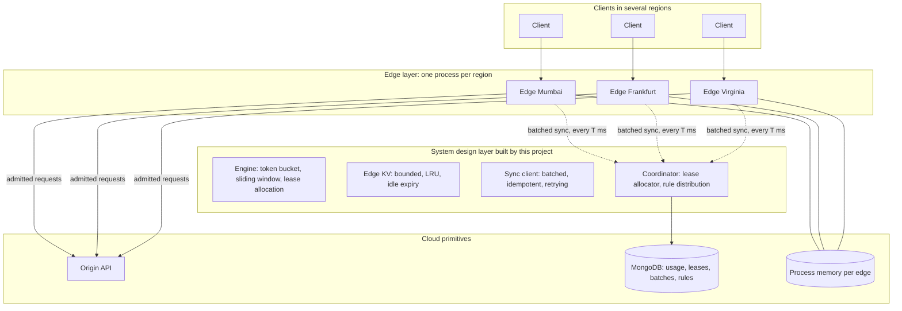

# Architecture

EdgeGate is an abstraction layer for rate limiting that sits above plain cloud primitives: stateless compute at the edge, an in-memory key-value store per node, and a managed document database for global state. It provides one guarantee on top of them: a global limit that holds across regions while every admission decision is made locally.

## Layers

The modules in `server/src` map onto the abstraction layer as follows.

| Module | Role |
| --- | --- |
| `engine` | Pure algorithms: token bucket, sliding-window counter, lease allocation |
| `kv` | Bounded in-memory store used by each edge for per-key state |
| `rules` | Rule schema, validation, request-to-key resolution |
| `edge` | Enforcer, sync client, reverse proxy, admission flow |
| `coordinator` | Sync service that applies usage and grants leases |
| `store` | MongoDB persistence for global usage, leases, batches and rules |
| `chaos` | Fault injection on the edge-to-coordinator link |
| `origin` | Stand-in protected API |

## Data and control paths

**Client request (data plane, no network hop to the coordinator)**

1. The edge resolves the request to a rule, a tier and a key such as `public-api|tenant:acme`.
2. If the key has a live lease, the request is checked against the lease and the token bucket and decided in memory.
3. If the key has no live lease and the coordinator looks reachable, the edge first syncs once to obtain one (first contact or an expired lease). This is the only case where a request waits on the network.
4. Admitted requests are proxied to the origin with `X-RateLimit-*` headers. Rejected requests get `429` and `Retry-After`.
5. Every outcome increments `pending.admitted` or `pending.denied` for the key.

**Background sync (control plane, every T ms per edge)**

1. The edge drains `pending` counts into a batch `{nodeId, epoch, seq, reports}` and sends it to the coordinator.
2. The coordinator claims `(nodeId, epoch, seq)` once, so replays are ignored, then adds the admitted counts to the global window counter with an atomic increment.
3. For each key it computes `available = limit - slidingUsage - leases held by other nodes`, splits it by recent demand, stores the node's new lease (replacing the previous one) and returns it.
4. The edge installs the lease for `2T`, minus whatever it admitted since the batch was drained. If the batch carried a newer rule set, the edge adopts it.

**Rule change**

An operator publishes a new rule set to the coordinator. Edges receive it on their next sync because they report the version they hold.

**Network boundaries**

Clients reach only the edges. Edges reach the origin and the coordinator. Only the coordinator reaches MongoDB. Edges hold no durable state.

## Why leases

A lease is budget the coordinator has reserved for one edge. While the coordinator is reachable, the sum of global usage and outstanding leases never exceeds the limit at the moment a lease is granted, so the global limit holds by construction instead of by estimation. A node's old lease is replaced, not added to, when it syncs, and leases abandoned by a crashed node are reclaimed after `3T`.

The sliding-window counter is an approximation (current window plus a weighted share of the previous one), so the guarantee is exact up to that approximation.

## Failure and edge-case strategy

| Situation | Behaviour | Bound or recovery |
| --- | --- | --- |
| Edge crashes | Restarts with empty memory and a new epoch; its previous lease is replaced on its first sync | Usage admitted since its last sync is lost, at most the lease it held |
| Coordinator unreachable from one edge | Existing lease is honoured until it expires, then the edge uses its fail mode. `bounded`: a static share `floor(limit / peers)` enforced by a local sliding window. `open`: admit. `closed`: reject | `bounded` overshoots the global limit by at most one local share per partitioned edge. After healing, the retained batch is re-sent and usage reconciles |
| Reply to a sync is lost | The edge re-sends the same batch with the same sequence number | Counted once because the coordinator rejects duplicate `(nodeId, epoch, seq)` |
| Coordinator crashes | Edges keep deciding from their leases, then fall back as above. MongoDB keeps coordinator state durable, so a restart resumes where it stopped | Unsynced edge-local usage can still be lost before its next batch |
| Edge starts before the coordinator | Boots with the bundled default rule set and uses its fail mode until the first sync succeeds | Rules and leases arrive on the first successful sync |
| Concurrent syncs for one key | Serialized by a per-key mutex in the coordinator | One active coordinator is assumed |
| Clock skew between edges | Window buckets are assigned by the coordinator clock on receipt; edges only use their clock for local refill and lease expiry | Lease hold time at the coordinator is longer than the edge's expiry, so skew cannot make both sides use the same lease |
| Key cardinality grows | Edge KV evicts least recently used keys that have nothing unreported | Soft cap is exceeded rather than losing unreported usage |
| Rule change | Versioned; keys retune in place without discarding pending usage | Takes effect on the next sync |

## Measured trade-off

`npm run bench` replays identical traffic (limit 100 per 60 s, 3 edges, 50 s) against each strategy. Selected rows from the skewed workload (edge rates 60 / 1 / 1 requests per second):

| Strategy | Admitted | Overshoot | Premature rejects | Coordinator calls |
| --- | --- | --- | --- | --- |
| No sync, full limit on each edge | 216 | 116% | 0 | 0 |
| Static split | 99 | 0% | 3035 | 0 |
| Central call per request | 100 | 0% | 0 | 3134 |
| Leased, sync every 100 ms | 100 | 0% | 10 | 1582 |
| Leased, sync every 1 s | 100 | 0% | 86 | 155 |
| Leased, sync every 5 s | 100 | 0% | 552 | 30 |

A premature reject is a request refused while the global budget was not yet used up. Shorter sync intervals reduce them at the cost of more coordinator traffic; the central strategy has none but needs a round trip per request, which the leased design avoids.
